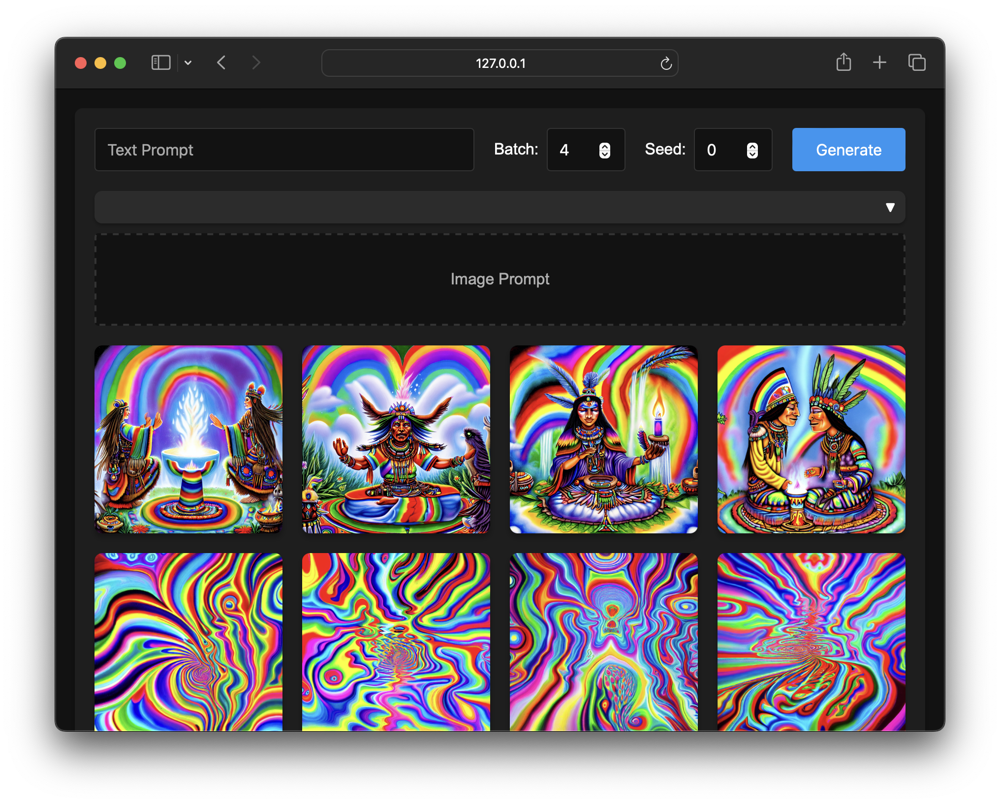
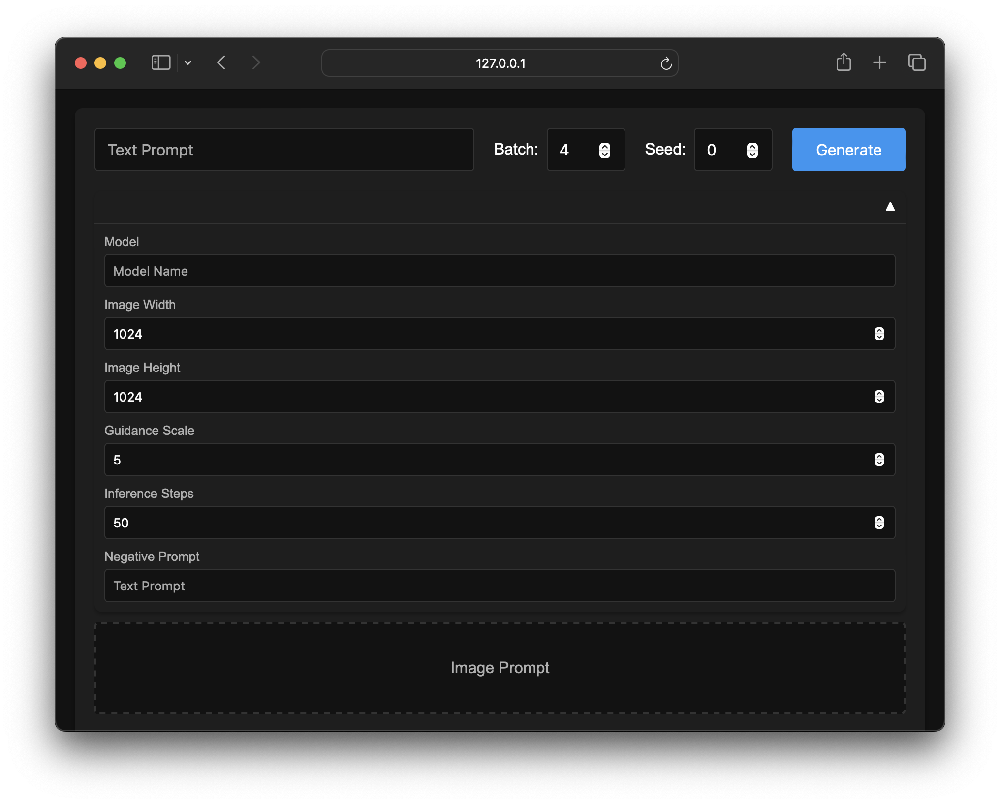

# imagine

> "*Imagination is the beginning of creation. You imagine what you desire, you will what you imagine, and at last you create what you will.*"
>     - George Bernard Shaw

<p align="center">
  <br>
  
  </br>
</p>

### Overview

`imagine` is a simple and extensible model-agnostic web interface for text-to-image generation. It relies on an external model server to generate images, while providing a minimal and extendible interface for specifying runs and persisting returned results and metadata in a database.

### Features

- Text-to-image and image-to-image generation capabilities.
- Batch image processing support.
- Persistent image and prompt database storage with complete metadata coverage.
- RESTful API backend for plug-and-play client-side model configuration.
- Extendible inference settings panel for fine-grained control of generations.
- Seamless ablation of prompting workflows across models.

### Model Inference

This application relies on an external model server for inference. Instead of performing inference directly within the application, predictions are made by sending requests to a configured model endpoint. This approach allows the front-end to remain model-agnostic by providing a consistent interface for common parameters like the random seed, batch size, and image resolution.

### Advanced Settings

There are three main arguments used when submitting generations:

- **Prompt**: Text description that specifies the contents and style of the image.
- **Batch**: Number of different images to generate in a single run.
- **Seed**: Random seed used to ensure reproducibility across identical runs.

An additional collapsible interface can be expanded for modifying other  inference arguments:

- **Guidance Scale**: Controls how closely the generated image aligns with the input prompt(s).
- **Inference Steps**: Determines the generation quality and detail. More steps produce greater detail at the cost of inference time.
- **Image Width**: Sets the output image width in pixels.
- **Image Height**: Sets the output image height in pixels.
- **Negative Prompt**: Text description that specifies what to avoid generating in the image.

<p align="center">
  <br>
  
  </br>
</p>

___

### Video

The `Video` tab generates clips and runs them as sweeps on a queue. The video model server wraps the powerful open-weights video model, [MiniMax-H3](https://huggingface.co/MiniMaxAI/MiniMax-H3); any server with the same request and response format can replace it.

Start a model server on the GPU machine, one per workflow:
```bash
# text only, start frame, end frame, or both.
poetry run python -m imagine.model.minimax.h3
# omni-reference: images, videos and audio named in the prompt.
poetry run python -m imagine.model.minimax.h3 --config-name h3_ref
```
The server follows the [`diffusers`](https://github.com/huggingface/diffusers) int8 recipe for a 24 to 32 GB card, which keeps about 75 GB of weights in host RAM, so the machine needs more memory than that. Check the model license covers your region before downloading the weights.

Start the application pointed at that machine, with the reloader off so a sweep is not restarted by a file change:
```bash
poetry run python -m imagine.app video_host=http://<gpu-machine> debug=false
```

A sweep is every combination of:

- **Prompts**: one per line. `{name}` is replaced by each value of the variable `name`.
- **Frame sets** or **reference sets**: each set is run with every prompt.
- **Durations**, **Resolutions**, **Inference Steps**: comma-separated lists.
- **Seeds per prompt**: consecutive seeds starting at **Seed**.

The table under the form shows the clips and estimated time for each configuration, and when the sweep would finish. Estimates are fitted to the clips that model has already finished; `Calibrate` runs two short clips to measure a model that has none. Queued sweeps run one clip at a time, survive the application restarting, and a failed clip does not stop the rest.

Any frame of a finished clip can start, end or steer a new one. Open the clip, step to the frame, and send it to `Start frame`, `End frame` or `Reference`. The app cuts the frame itself and records the clip and frame number it came from, which the new clip shows in its details. To edit a frame elsewhere, download it from its slot and drop the edited file back on the same slot: it is kept as a new version of that frame, not as a separate image.

To try the interface without a GPU, run the stand-in server, which returns test clips:
```bash
poetry run python -m imagine.model.minimax.stub
poetry run python -m imagine.app model_host=http://localhost debug=false
```
___

### Quickstart
Install the package:
```bash
git clone https://github.com/dnl-strnl/imagine.git
cd imagine/
poetry install
```
Run the tests:
```bash
poetry run pytest
```
Start the model server:
```bash
poetry run python3 -m imagine.model.qwen.image_edit
```
Edit an image from the CLI:
```bash
poetry run python3 -m imagine.model.client data.image=path/to/image.png data.prompt="..."
```
Start the application:
```bash
poetry run python -m imagine.app model.host=http://localhost model.port=44773
```
Navigate to `http://127.0.0.1:5678`, enter a prompt, and click `Generate`.
